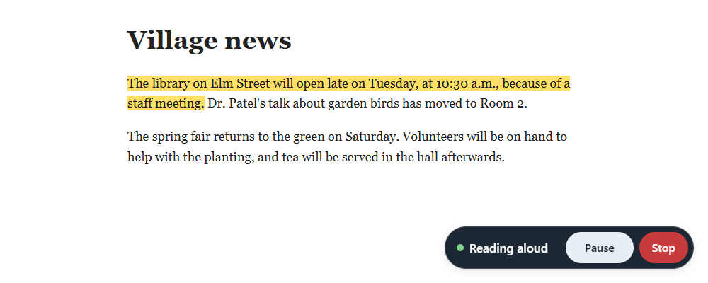
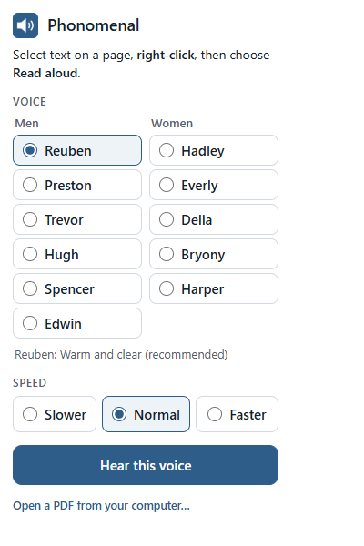
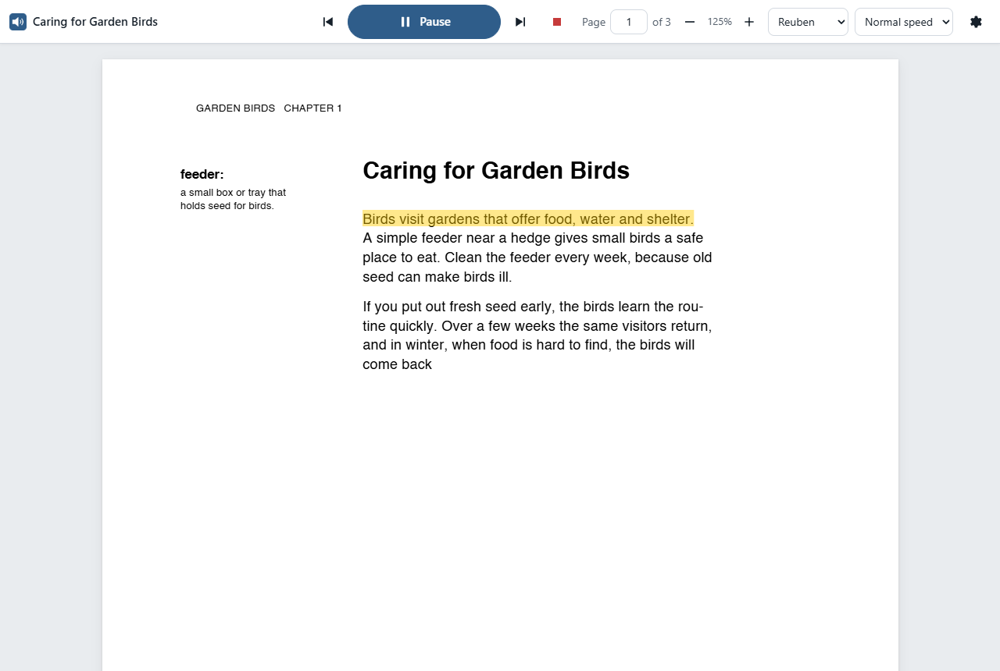

# Phonomenal Free TTS

Before you say anything, yes this was put together with AI. I honestly just wanted a quick, nice sounding TTS for my mom so sue me. Everything else on the chrome extension store sounded so bad and was trying to price gouge its users so take this for free.

Select text on any web page, right-click, choose **Read aloud**, and it reads the text in a natural voice, highlighting each sentence. Press **Continue reading** when it finishes to keep going down the page.

- The voice is Phonon 31M, and it runs entirely on your own computer.
- No account or internet is needed, and nothing you select is sent anywhere.
- It works on Windows and macOS in Google Chrome 121+ and Chrome-based browsers (Edge, Brave), and in Firefox 128+.

**Download:** get `phonomenal-free-tts-<version>.zip` from the [latest release](https://github.com/prosprit/Phonomenal-Free-TTS/releases/latest), then follow the steps below. You can also download this repository and use its `extension` folder.

   
  

## Install in Chrome, Edge or Brave (about 2 minutes)

1. If someone sent you `phonomenal-free-tts-<version>.zip`, unzip it to a permanent place such as Documents. Chrome runs the extension from that folder, so don't move or delete it.
2. Type `chrome://extensions` in the address bar (`edge://extensions` in Edge) and press Enter.
3. Turn on **Developer mode** (top-right).
4. Click **Load unpacked** and choose the `extension` folder, the one that contains `manifest.json`.
5. A welcome page opens. Click **Read this to me**.
6. Pin the icon: click the puzzle-piece icon at the top-right, then click the pin next to **Phonomenal Free TTS**.

## Install in Firefox

Until it is signed by Mozilla, Firefox only loads it **until Firefox is closed**.

1. Type `about:debugging#/runtime/this-firefox` in the address bar and press Enter.
2. Click **Load Temporary Add-on…** and choose `extension/manifest.json`.

For a permanent install, the add-on needs signing on addons.mozilla.org. An "unlisted" signing is free and keeps it private. You then get a `.xpi` file that friends install with a double-click.

In Firefox the voice uses one processor core instead of three. It still reads about three times faster than it speaks.

## Use it

| To… | Do this |
|---|---|
| Read something | Select text, right-click it, choose **Read aloud**. It reads what you selected, highlighting each sentence |
| Keep going | When it finishes, press **Continue reading** (just below the text). It reads on to the end of the article and scrolls with it |
| Jump to another part | While it keeps going, click any sentence. Or select some words and press **Read from here** |
| Stop | Click the red **Stop** at the bottom-right of the page, or press **Esc** |
| Pause | **Pause** on the same bar, then **Resume** |
| Use the keyboard | Select text, then press **Alt+Shift+R** (Mac: **Option+Shift+R**). Press it again to stop |
| Change voice or speed | Click the Phonomenal icon. Pick a voice (6 men, 5 women) and Slower, Normal or Faster, then click **Hear this voice** |

## Read a whole PDF

1. Open the PDF in your browser. Then do one of these:
   - Click the Phonomenal icon and choose **Read this PDF**.
   - Right-click the page (with nothing selected) and choose **Read this PDF aloud**.
   - Press **Alt+Shift+R** with nothing selected.
2. The PDF opens in the Phonomenal reader. Press **Read from page N** to start at the page you're looking at.

While it reads:

- **Read from anywhere.** Click any sentence, or select some words, then press **Read from here**. While it's reading, a click jumps straight to that sentence.
- **Follow along.** The sentence being read is highlighted, and the page scrolls with it. If you scroll away, a **Back to where it's reading** button appears.
- **Controls.** ⏮ and ⏭ skip back and forward a sentence (**Shift+←/→**). **Space** pauses and **Esc** stops. Voice and speed are in the top bar.
- **Remembers your place.** Open the same PDF later and press **Continue reading**.
- **Reads it like a book.** It skips page headers and page numbers, joins words split across lines, and reads a sentence that runs onto the next page in one go. Side notes and boxes are read at the end of each page; you can turn them off in ⚙.
- **Just a few words.** In the browser's own PDF viewer, select them, right-click, and choose **Read aloud**.

The first time you read a PDF from a website, Phonomenal asks to **Allow** that site once.

- **PDFs on your computer in Chrome:** turn on **Allow access to file URLs** for Phonomenal once in `chrome://extensions`. Or open the reader from the icon (**Open a PDF from your computer…**) and choose the file.
- **PDFs on your computer in Firefox:** always choose the file that way.

## Good to know

- **First sound.** The first read after starting the browser takes about a third of a second while the voice loads. After that, speech starts almost instantly.
- **What Continue reading reads.** The rest of the article: it skips menus, sidebars, tables, picture captions and citation marks like [1], and stops before sections such as References or See also.
- **Browser pages.** The browser's own pages and the add-on stores don't allow the on-page buttons, highlighting or Continue reading. Reading the selection still works there; stop it from the icon.
- **Backup voice.** If the natural voice ever fails to start, it uses your computer's built-in voice instead.

## For whoever maintains it

- **The large files are already in `extension/`** (runtime, model, voices, icons). To rebuild them after an update:
  1. Run `npm install phonon-tts` in the repo root.
  2. Download `gradium/phonon-31m-en` and `gradium/phonon-voices` from Hugging Face into its cache.
  3. Run `python scripts/assemble.py` (needs Pillow).
- **Make a shareable zip** (`dist/phonomenal-free-tts-<version>.zip`): `python scripts/package.py`
- **How it works**
  - PDFs: `reader.html` shows the PDF with PDF.js (Apache-2.0, in `vendor/pdfjs`). `pdftext.js` turns each page into paragraphs and sentences in reading order. `engine.js` speaks them one at a time, a few seconds ahead of playback, so the highlight can follow exactly.
  - Chrome: the service worker sends text to an offscreen document that runs `player.js`.
  - Firefox: the background event page runs `player.js` itself. While reading, the on-page bar pings every 10 s so Firefox doesn't unload it mid-sentence.
- **Licences.** The Phonon model and voices are Apache-2.0 (Gradium). The phonon-tts runtime is MIT OR Apache-2.0. PDF.js (Mozilla) is Apache-2.0. See `extension/model/LICENSE`, `extension/vendor/phonon-tts/` and `extension/vendor/pdfjs/LICENSE`.
